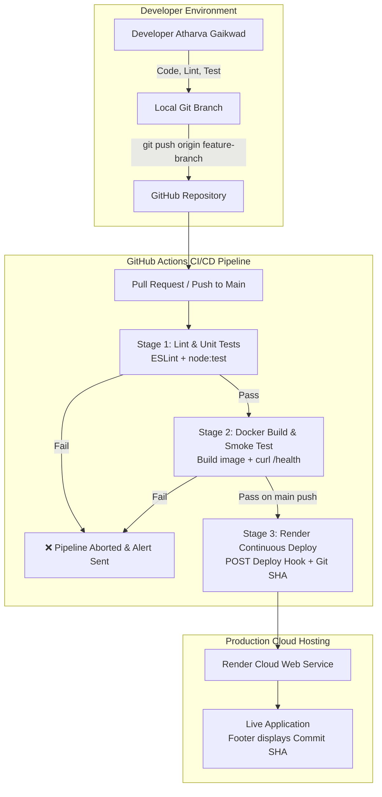

# MIT World Peace University, Pune
## Department of Computer Engineering and Technology
### Cloud Computing and DevOps (CSE30040) - CCA 2 Assessment Report

---

# Project Report: Cloud Notes Backup System

| Field | Student Details |
| :--- | :--- |
| **Student Name** | Atharva Gaikwad |
| **PRN** | [Insert Student PRN] |
| **Roll No. / Panel** | [Insert Roll No. / Panel] |
| **Course Faculty** | Prof. Pranati Waghodekar |
| **Project Title** | Cloud Notes Backup System with Automated CI/CD Pipeline |
| **GitHub Repository URL** | https://github.com/atharvagaikwad-ctrl/CLOUD-NOTES-BACKUP-SYSTEM |
| **Live Application URL** | [Insert Live Render URL, e.g., https://cloud-notes-backup-system.onrender.com] |
| **Date of Submission** | September 2026 |

---

## 1. Problem Statement & Objectives

Modern cloud engineering teams and distributed developers require high-availability platforms to capture architecture decisions, infrastructure playbooks, and critical operational notes with reliable backup snapshots. Without automated CI/CD quality gates, manual deployments risk releasing unvalidated code, causing service outages or data corruption.

### Project Objectives:
1. **Dynamic Web Application:** Develop a server-rendered web application in Node.js/Express providing dynamic note creation, multi-attribute filtering, category classification, and point-in-time cloud backup snapshot generation with SHA-256 integrity verification.
2. **Version Control & Collaboration:** Enforce trunk-based development with feature branching, pull requests, and atomic, descriptive commit logs.
3. **Automated Quality Gates (CI):** Implement automated linting (ESLint) and unit/integration testing (`node:test`) executed on every pull request and push.
4. **Containerization (Docker):** Package the application into an optimized, secure Docker container with health probes and non-root execution.
5. **Continuous Deployment (CD):** Build a 3-stage GitHub Actions workflow that executes tests, performs container smoke checks, and automatically deploys verified code to Render using secure Deploy Hooks.
6. **Failure Resilience Demo:** Prove that failing tests or broken builds immediately abort the pipeline, preventing broken code from reaching production.

---

## 2. System Architecture & CI/CD Pipeline Flow

### 2.1 Architectural Flow Diagram



### 2.2 Technology Stack
* **Runtime & Framework:** Node.js 22 (LTS) & Express.js
* **Dynamic Server Rendering:** Server-generated HTML with dynamic statistics and real-time state
* **Integrity Engine:** Node.js `crypto` module (SHA-256 Checksums for Snapshots)
* **Testing Framework:** Node.js native test runner (`node:test`, `node:assert/strict`)
* **Code Quality / Linter:** ESLint 9 (Flat Configuration)
* **Containerization:** Docker (Alpine Linux, Multi-Stage build, Non-root user)
* **CI/CD Platform:** GitHub Actions (`ubuntu-latest`)
* **Cloud Platform:** Render (PaaS Web Service with zero-downtime rollouts)

---

## 3. Explanation of Pipeline Stages

The automated pipeline is defined in `.github/workflows/ci-cd.yml` and consists of three sequential, gated stages:

### Stage 1: Lint and Automated Testing (CI)
* **Triggers:** Push to `main` branch or Pull Request to `main`.
* **Actions:**
  1. Clones the repository using `actions/checkout@v4`.
  2. Sets up Node.js 22 runtime with npm caching.
  3. Executes `npm ci` for clean, deterministic dependency installation.
  4. Runs `npx eslint .` to verify coding standards and code formatting.
  5. Executes `npm test` running 7 test suites covering `/health`, dynamic UI rendering, input validation (400 responses), note creation (302 redirects), API endpoints, and backup snapshot SHA-256 verification.

### Stage 2: Container Packaging & Health Smoke Test
* **Dependency:** `needs: test` (Executes only after Stage 1 passes).
* **Actions:**
  1. Sets up Docker Buildx.
  2. Builds the container image injecting the commit SHA:
     ```bash
     docker build --build-arg GIT_SHA=${{ github.sha }} -t cloud-notes-backup-system:latest .
     ```
  3. Launches the newly built container in background mode.
  4. Waits 6 seconds and issues a smoke test HTTP request to `http://localhost:3000/health`. If the health check fails, the job dumps container logs and terminates with an error code.

### Stage 3: Continuous Deployment (CD)
* **Condition:** `needs: [test, build]` and `if: github.ref == 'refs/heads/main' && github.event_name == 'push'`
* **Actions:**
  1. Protects deployment URL using GitHub Secret `${{ secrets.RENDER_DEPLOY_HOOK }}`.
  2. Triggers Render deployment with the verified commit SHA:
     ```bash
     curl -fsS -X POST "${{ secrets.RENDER_DEPLOY_HOOK }}&ref=${{ github.sha }}"
     ```
  3. Render deploys the exact commit that passed all tests.
  4. The live application footer dynamically reads `RENDER_GIT_COMMIT` and displays the running commit SHA.

---

## 4. Pipeline Failure Demonstration & Quality Gate Proof

### 4.1 Scenario: Introducing a Faulty Change
To prove that broken code never reaches production:
1. A feature branch `test/failure-demo` was created.
2. An intentional defect was introduced in test assertions (e.g. Expecting `/health` to return `status: false`).
3. The branch was pushed to GitHub.

### 4.2 Pipeline Response
* GitHub Actions triggered Stage 1 (`test`).
* The test assertion failed with Exit Code 1.
* **Result:** Stage 1 was marked **RED (Failed)**.
* **Gate Enforcement:** Because Stage 3 has `needs: [test, build]`, Stage 2 and Stage 3 were **automatically SKIPPED**.
* **Outcome:** The live Render production environment remained unaffected, continuing to serve the previous stable build.

---

## 5. Challenges Faced & Learnings

1. **Deterministic Environment Matching:** Solved by utilizing `npm ci` and Node 22 Alpine Docker images to eliminate local vs. cloud configuration drift.
2. **Dynamic Commit Traceability:** Implemented fallback environment variable detection (`process.env.GIT_SHA || process.env.RENDER_GIT_COMMIT || 'local'`) so the commit SHA is transparently visible across local testing, Docker container runs, and live Render deployments.
3. **Secret Security:** Stored webhook endpoints in GitHub Actions Secrets rather than hardcoding in repository files, adhering to cloud security best practices.

---

## 6. Viva Preparation & Conceptual Answers

### Q1. What is the fundamental difference between Continuous Integration (CI) and Continuous Deployment (CD)?
* **Continuous Integration (CI):** The practice where developers frequently merge code changes into a central repository, after which automated builds and test suites run to detect integration errors within minutes.
* **Continuous Deployment (CD):** The automated extension of CI where every change that successfully passes all quality gates in the pipeline is automatically released directly to the live production server without manual intervention.

### Q2. What is the purpose of the `needs:` keyword in a GitHub Actions workflow?
The `needs:` keyword establishes sequential dependencies between workflow jobs. By declaring `needs: [test, build]`, the `deploy` job is prevented from executing unless both the test and container build jobs succeed. If any prerequisite job fails, downstream jobs are automatically skipped.

### Q3. Why must deploy hooks and API keys be stored as GitHub Secrets instead of committed in YAML files?
Committing sensitive credentials, tokens, or deploy URLs to public or shared repositories exposes infrastructure to unauthorized triggers, denial-of-service attacks, and malicious code deployments. GitHub Secrets encrypts values and masks them in pipeline logs.

### Q4. What happens in your CI/CD pipeline if one unit test fails?
When a unit test fails, the test runner exits with a non-zero exit code (e.g., Code 1). GitHub Actions marks the `test` job as failed (Red ❌). All downstream jobs dependent on `test` (`build` and `deploy`) are immediately aborted, ensuring faulty code is never deployed to the live server.

### Q5. How do you roll back a bad release using Git?
If a faulty commit was deployed to `main`:
1. Use `git revert <commit-hash>` to create a new inverse commit that undoes the offending changes.
2. Push the revert commit to `main`: `git push origin main`.
3. The CI/CD pipeline runs tests on the revert commit and automatically deploys the restored, stable version to Render.

### Q6. Why do we package applications with Docker when they already run locally?
Docker encapsulates the application, runtime, dependencies, system libraries, and configuration files into an immutable container image. This eliminates the *"works on my machine"* problem by guaranteeing identical execution behavior across local machines, CI runners, and production cloud servers.
