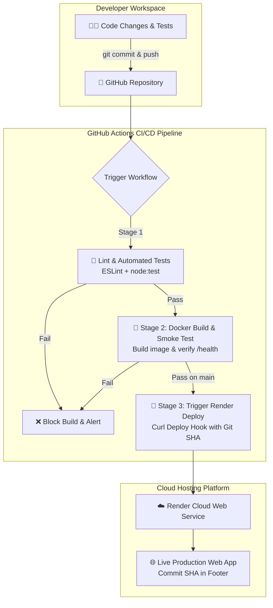

# ☁️ Cloud Notes Backup System

[](https://github.com/atharvagaikwad-ctrl/CLOUD-NOTES-BACKUP-SYSTEM/actions/workflows/ci-cd.yml)
[](https://nodejs.org)
[](https://www.docker.com/)
[](https://render.com)
[](LICENSE)

An enterprise-grade **Cloud Notes Backup System** built for the **Cloud Computing and DevOps (CSE30040) CCA 2 Submission** at **MIT World Peace University (MIT-WPU)**.

Developed by: **Atharva Gaikwad** ([@atharvagaikwad-ctrl](https://github.com/atharvagaikwad-ctrl))

---

## 📌 1. Project Overview & Architecture

The **Cloud Notes Backup System** is a dynamic web application providing cloud engineers, DevOps practitioners, and students a resilient note-taking and cloud backup snapshot management platform.

### Key Architectural Highlights:
* **Server-Rendered Dynamic Web UI:** Dynamic HTML views generated on the fly by Express.js with form handling, filtering, and sanitization.
* **Cloud Backup Snapshot Engine:** Point-in-time snapshot generator computing **SHA-256 integrity checksums**, with one-click JSON snapshot download and instantaneous state restoration.
* **Continuous Integration (CI):** ESLint quality gates and automated unit/integration tests running on Node 22 via GitHub Actions on every pull request and push.
* **Containerized Packaging (Docker):** Alpine-based lightweight container image with non-root security execution.
* **Continuous Deployment (CD):** Push-to-main automated deployment triggering Render Deploy Hook passing the exact verified Git SHA (`&ref=${{ github.sha }}`).
* **Commit Traceability:** Running commit hash displayed dynamically in the web UI footer (`RENDER_GIT_COMMIT` / `GIT_SHA`).



---

## 🚀 2. Features

* **Dynamic Note Management:** Create, categorize (DevOps, Cloud, Architecture, Security, General), prioritize (Low, Medium, High), and tag notes.
* **Input Validation & Sanitization:** Server-side XSS protection and strict input validation (400 Bad Request on invalid payloads).
* **Automated Cloud Snapshots:** Instant snapshot generation with byte-size calculation and SHA-256 hash checksums.
* **Backup Download & Restore:** Download point-in-time snapshots as structured JSON or restore system state directly.
* **Real-time Filter & Search:** Multi-attribute filtering across title, content, tags, category, and priority.
* **Health & Diagnostics:** Dedicated `/health` probe and `/api/stats` endpoint for uptime monitoring and metrics.

---

## 📡 3. REST API Specification

| Method | Route | Description | Request Body / Query | Success Response |
| :--- | :--- | :--- | :--- | :--- |
| `GET` | `/health` | Application health check probe | None | `200 OK` + `{"status":"ok","commit":"...","uptimeSeconds":...}` |
| `GET` | `/api/notes` | List and search cloud notes | `?query=...&category=...&priority=...` | `200 OK` + `{"count":N,"notes":[...]}` |
| `POST` | `/api/notes` | Create a new note | `{"title":"...","category":"...","priority":"...","tags":["..."],"content":"..."}` | `201 Created` + note object |
| `DELETE` | `/api/notes/:id` | Delete a note by ID | None | `200 OK` + `{"message":"Note deleted successfully"}` |
| `GET` | `/api/backups` | List all backup snapshots | None | `200 OK` + `{"count":N,"snapshots":[...]}` |
| `POST` | `/api/backups` | Create new backup snapshot | `{"snapshotName":"..."}` | `201 Created` + snapshot object |
| `GET` | `/api/backups/:id/download` | Download JSON snapshot file | None | `200 OK` (JSON attachment) |
| `GET` | `/api/stats` | Storage and count metrics | None | `200 OK` + stats JSON |

---

## 🛠️ 4. Local Development & Testing

### Prerequisites
* [Node.js](https://nodejs.org) >= 20.x
* [Docker Desktop](https://www.docker.com/) (optional, for container runs)
* [Git](https://git-scm.com/)

### 1. Clone & Install
```bash
git clone https://github.com/atharvagaikwad-ctrl/CLOUD-NOTES-BACKUP-SYSTEM.git
cd CLOUD-NOTES-BACKUP-SYSTEM
npm install
```

### 2. Run Automated Quality Gates
```bash
# Run ESLint check
npm run lint

# Run Automated Test Suite (7 unit & integration tests)
npm test
```

### 3. Start Local Web Server
```bash
npm start
# Server starts at http://localhost:3000
```

### 4. Run via Docker
```bash
# Build Docker image
docker build -t cloud-notes-backup-system .

# Run Container
docker run -p 3000:3000 cloud-notes-backup-system

# Verify Health
curl http://localhost:3000/health
```

---

## 🔄 5. CI/CD Pipeline Configuration (GitHub Actions & Render)

The pipeline is defined in [`.github/workflows/ci-cd.yml`](.github/workflows/ci-cd.yml).

### Workflow Stages:
1. **Stage 1 (test):** Checks out code, sets up Node 22, installs dependencies (`npm ci`), executes ESLint (`npx eslint .`), and runs automated tests (`npm test`).
2. **Stage 2 (build):** Builds container image via Docker Buildx with `--build-arg GIT_SHA`, launches the container in CI, and executes a smoke test against `http://localhost:3000/health`.
3. **Stage 3 (deploy):** Conditional job (`github.ref == 'refs/heads/main' && github.event_name == 'push'`). Calls the Render Deploy Hook secret with the verified Git commit SHA:
   ```bash
   curl -fsS -X POST "${{ secrets.RENDER_DEPLOY_HOOK }}&ref=${{ github.sha }}"
   ```

### Render Setup Instructions:
1. Log in to [Render](https://render.com) using your GitHub account.
2. Click **New +** &rarr; **Web Service**.
3. Select your repository: `atharvagaikwad-ctrl/cloud-notes-backup-system`.
4. Configure service settings:
   * **Environment:** `Node` or `Docker`
   * **Build Command:** `npm ci`
   * **Start Command:** `node server.js`
   * **Health Check Path:** `/health`
   * **Auto-Deploy:** **OFF** (GitHub Actions orchestrates continuous deployment).
5. Navigate to **Settings** &rarr; **Deploy Hook** &rarr; Copy the URL.
6. In GitHub repository: **Settings** &rarr; **Secrets and variables** &rarr; **Actions** &rarr; **New repository secret**:
   * Name: `RENDER_DEPLOY_HOOK`
   * Value: `<Paste your Render Deploy Hook URL>`

---

## 🧪 6. Proving Pipeline Integrity (Failure Demo)

To demonstrate quality gate enforcement:
1. Create a test branch: `git checkout -b test-failure-demo`
2. Intentionally modify a test expectation in [`test/app.test.js`](test/app.test.js) to fail.
3. Push to GitHub: `git push -u origin test-failure-demo`
4. Observe the GitHub Actions run: **Stage 1 fails (Red ❌)**, and **Stage 3 (Deploy) is automatically blocked/skipped**.
5. Revert the faulty test, push again, and verify the pipeline passes (**Green ✅**) and triggers production deployment.

---

## 📄 7. License & Acknowledgments

This project is submitted for the **Cloud Computing and DevOps (CSE30040)** coursework at **MIT World Peace University, Pune**.

Course Faculty: **Prof. Pranati Waghodekar**  
Student: **Atharva Gaikwad**
